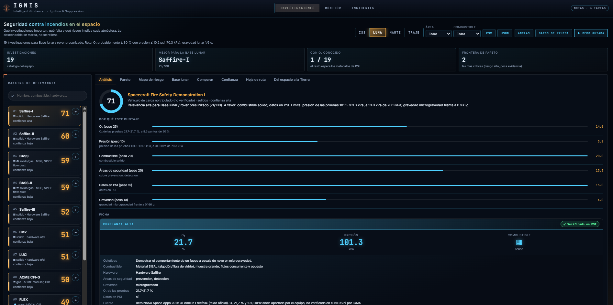
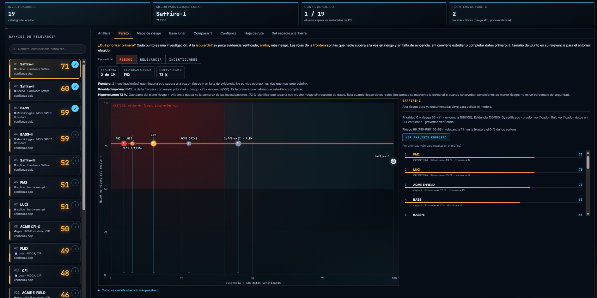
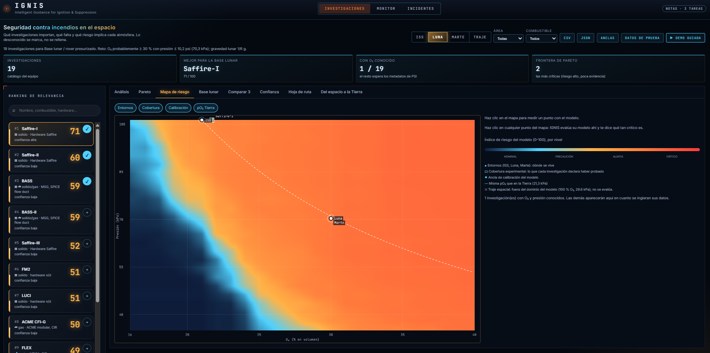
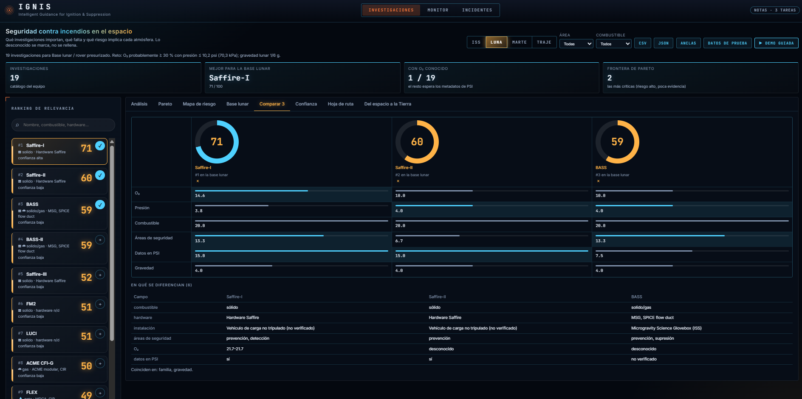
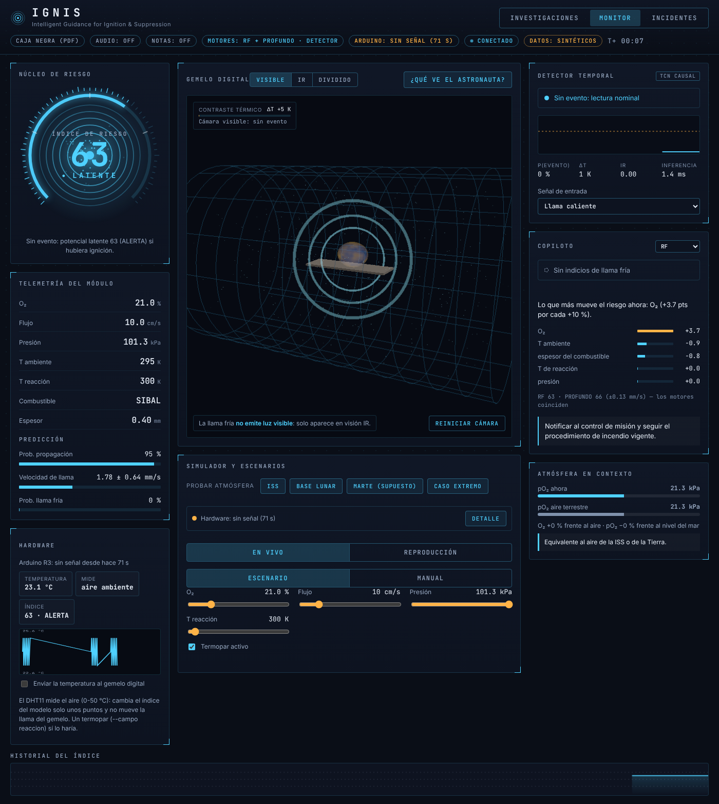

# IGNIS — Intelligent Guidance for Ignition & Suppression

IGNIS is an SI-powered dashboard that summarizes, ranks, and interprets NASA PSI combustion investigations for fire safety in space exploration.
A 3D digital twin is included as a complement.

NASA Space Apps Challenge 2026 · Hermosillo · *Flame in Freefall: SI-Powered Fire Safety Insights from Microgravity Combustion Data*.



## What it solves
Decades of microgravity fire data are hard to find, compare, and interpret. IGNIS:
1. **Ranks** the investigations (BASS, Saffire, FLEX, ACME…) by relevance to the chosen environment, with the breakdown of every score.
2. **Prioritizes** with a Pareto frontier (risk × evidence): what to investigate first, and with what uncertainty.
3. **Maps** atmospheric risk (O₂ × pressure) and where experimental evidence exists; any point can be evaluated with a click.
4. **Compares** 2 to 4 investigations side by side: who wins on each component and where they differ.
5. **Evaluates the lunar atmosphere** (≥ 30 % O₂, ≤ 70.3 kPa) against the ISS and opens it in the Monitor.
6. **Updates itself** when new data arrive (sample CSV or real ingestion), flagging rows as TEST or NEW, and reports data-quality issues (empty rows, duplicates, typos) to the researcher.
7. **Confidence report** per investigation: how much of each input is verified, inferred, or assumed, with PDF export.
8. **Researcher notes**: per-investigation notes, a task checklist, and TXT export, stored locally in the browser.

| Pareto | Risk map | Compare |
|---|---|---|
|  |  |  |

## Try it in 90 seconds
`make run` → open <http://localhost:8000> → click **▶ Guided demo** (it walks through everything, loads a sample CSV, and removes it on exit).
To try your own data: **Test data → Upload my CSV** (columns: investigation, O₂, flow, pressure with unit, fuel…).

## Scientific honesty (read before using)
- The risk model was trained on **synthetic data calibrated with 3 published anchors**: it ranks and prioritizes; it does **not predict** real fires and has not been validated by domain experts.
- Only 1 of 19 investigations currently has verified O₂ and pressure; PSI metadata is read as it is published. Unknowns are flagged, never filled in.
- The interpretation is **deterministic** (rules over the score breakdown), not an LLM.
- PSI holds no partial-gravity data; the Moon is an extrapolation and is declared as such.
- An experimental **gas mode** (`modo="gas"`) exists as a separate model trained on 323 CFI-G (PSI-159) tests. It predicts hot-ignition probability and burn time, is not part of the solid-fuel risk index, and is flagged as experimental.
- Requirement-by-requirement detail: [`docs/cumplimiento_reto.md`](docs/cumplimiento_reto.md) · limits: [`docs/science.md`](docs/science.md).

## Monitor and hardware (complement)
3D digital twin, temporal cool-flame detector, copilot, and an Arduino bridge (`hardware_bridge.py`). A DHT11 sensor measures the air and barely
moves the index; a thermocouple on the flame does feed the twin. The hardware chip shows "Disconnected" when no device is present.


## Quick start
```bash
python -m venv .venv && source .venv/bin/activate
make instalar          # pip + npm (Three.js is vendored)
cp .env.example .env
make run               # http://localhost:8000  (HUD)  ·  /docs (API)
```
`modelos/*.pt` are pretrained; `make entrenar` regenerates them.

## With Docker (one command)
```bash
docker compose up --build      # HUD at http://localhost:8000  ·  API at /docs
```
Place NASA data in `data/raw/` and ingest it with `docker compose exec ignis python scripts/ingestar_datos_nasa.py`.

## Main endpoints
| Method | Route | Purpose |
|---|---|---|
| GET | `/health` | Liveness, components, and engines |
| POST | `/api/v1/predict?motor=&explicar=` | Evaluate one condition |
| POST | `/api/v1/explain` · `/predict/batch` | Factors · up to 500 conditions |
| GET | `/api/v1/modelo/estado` · `/modelo/reporte` | Model status and metrics |
| GET | `/api/v1/datos/versiones` | Dataset versions |
| GET | `/api/v1/incidentes` · `/{id}` · `/{id}/simular` | Incidents and human-vs-IGNIS comparison |
| WS | `/ws/sensores` · `/ws/predict` · `/ws/demo` | Sensors→detector · evaluation · scenario |

## Cinematic replay (HUD)
In the Monitor, *Simulator → Replay* plays scenarios (Nominal, Escalation, Mitigation, Residual cool flame) and
incidents (Mir 1997, ISS 2015 false alarm, Apollo 1, Saffire I–VI) at 0.5×/1×/2×/10× with a dual timeline,
latency breakdown, and "what if". Results are computed by the RF/deep model and the TCN detector
(`GET /api/v1/escenarios/{id}/reproduccion`); the script inputs are illustrative and labeled as such.

## Tests
```bash
pytest
node --test frontend/test/*.test.mjs
```

## Authors and license
Authors: **Cristobal Martinez** (Universidad de Sonora) and **Elías Navarro López** (Instituto Tecnologico de Hermosillo).
Licensed under [MIT](LICENSE) · cite as in [CITATION.cff](CITATION.cff).
Real PSI data: `docs/psi_integracion.md` · external validation: `docs/validacion_externa.md` · pitch: `docs/pitch*.md`.
